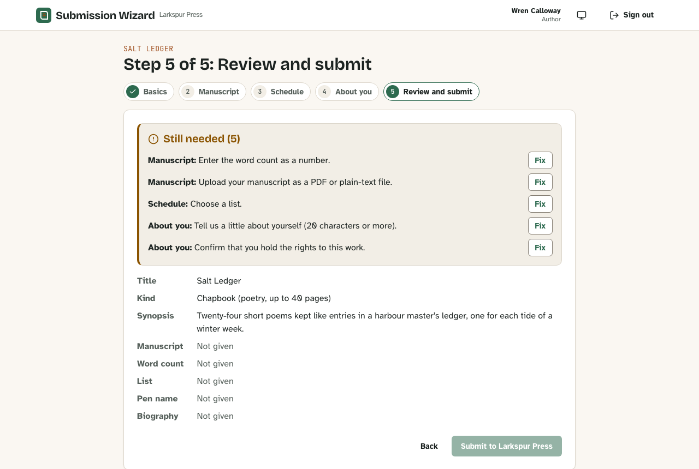

# Submission Wizard

[](https://github.com/Nawfaldev19/autosave-submission-wizard/actions/workflows/ci.yml)
[](https://scorecard.dev/viewer/?uri=github.com/Nawfaldev19/autosave-submission-wizard)
[](LICENSE)

A submission wizard that saves each step as the author moves on, and an editorial review queue, for a small independent press.



## Engineering highlights

- **A stale tab cannot overwrite a newer save, and typed work survives the conflict.** Every write carries a version matched in one `UPDATE` (`updateWithVersion` in [`domain/submissions.ts`](server/src/domain/submissions.ts)); the step form outlives uploads and conflicts ([`useStepForm.ts`](web/src/wizard/useStepForm.ts)).
- **The workflow is data, backed by the database.** One transition table ([`shared/src/workflow.ts`](shared/src/workflow.ts)) is applied by one locked `transition()`, and check constraints in [`0001_init.sql`](server/src/db/migrations/0001_init.sql) refuse invalid states even from raw SQL.
- **Queue pages stay stable while work arrives.** Keyset cursors on `(submitted_at, id)` keep Postgres's microseconds, which a JavaScript `Date` would drop (`reviewQueue` in [`domain/submissions.ts`](server/src/domain/submissions.ts)).
- **Uploads are judged by their bytes.** The whole file must be a PDF or valid UTF-8, it is stored under a random key, and downloads are sandboxed ([`uploads.ts`](shared/src/uploads.ts), [`storage.ts`](server/src/domain/storage.ts)).
- **Expected failures are typed.** Mutations return unions such as `ConflictError { currentVersion }` instead of error strings ([`errors.ts`](server/src/domain/errors.ts), [`schema.ts`](server/src/graphql/schema.ts)), and the same Zod rules run in the browser and on the server ([`shared/src/submission.ts`](shared/src/submission.ts)).

## Quick start

You need Node 22.12+ or 24+ and a PostgreSQL server reachable through `DATABASE_URL` or the `PG*` variables.

```bash
npm ci
npm run db:setup   # creates and seeds submission_wizard_development; empties it first
npm run dev        # app on http://localhost:5180, API on :4400
```

Or run `docker compose up` and open <http://localhost:5180>. Sign in with a one-click demo button, or as `wren@example.com` (author) or `hollis@example.com` (editor), password `submission-wizard-demo-pass`. All people and works are fictional. The [tutorial](docs/tutorials/getting-started.md) walks through a full submission.

## Features

| ID                                                                                 | Feature                                                               |
| ---------------------------------------------------------------------------------- | --------------------------------------------------------------------- |
| [F-01](docs/reference/features.md#f-01-sign-in-sessions-and-sign-out)              | Sign-in, sessions and sign-out, with server-side revocation           |
| [F-02](docs/reference/features.md#f-02-five-step-submission-wizard)                | Five-step submission wizard that saves on advance and resumes         |
| [F-03](docs/reference/features.md#f-03-readiness-checklist-and-fix-links)          | Readiness checklist with Fix links that focus the missing field       |
| [F-04](docs/reference/features.md#f-04-conflict-recovery-for-stale-tabs)           | Conflict recovery for stale tabs that keeps typed edits               |
| [F-05](docs/reference/features.md#f-05-unsaved-changes-guard)                      | Unsaved-changes guard on links, Back, sign-out and closing the tab    |
| [F-06](docs/reference/features.md#f-06-manuscript-upload-and-protected-download)   | Manuscript upload checked by content, and protected download          |
| [F-07](docs/reference/features.md#f-07-submit-withdraw-and-revise)                 | Submit, withdraw and revise through one workflow table                |
| [F-08](docs/reference/features.md#f-08-submissions-list-copies-and-inbox)          | Submissions list, copies and an inbox with read state                 |
| [F-09](docs/reference/features.md#f-09-accepted-submissions-with-locked-fields)    | Accepted submissions with locked fields that explain themselves       |
| [F-10](docs/reference/features.md#f-10-review-queue-with-filters-and-keyset-pages) | Review queue with filters and keyset pages                            |
| [F-11](docs/reference/features.md#f-11-claim-accept-or-decline)                    | Claim, accept with a release date, or decline with a note             |
| [F-12](docs/reference/features.md#f-12-app-shell-and-responsive-layout)            | App shell and responsive layout: themes, focus, titles, from 320px up |

## Tech stack

TypeScript in three npm workspaces: `shared/` (Zod rules), `server/` (GraphQL Yoga, Pothos with the errors plugin, Drizzle on PostgreSQL) and `web/` (React 19, React Router 7, urql, React Hook Form, Vite). Tests use Vitest in Node and browser mode, and Playwright.

## Documentation

The [documentation map](docs/README.md) has the tutorial, how-to guides, reference (features, API, data model, configuration) and explanation ([architecture](docs/explanation/architecture.md), [decision records](docs/adr/README.md)). Test counts and coverage are in the [testing strategy](docs/testing/strategy.md).

## Limitations

- One API process: the rate limiter is in memory and manuscripts are stored on local disk.
- Sessions last 12 hours and are not renewed; signing out ends every session of the account.
- No email delivery, sign-up or password reset; accounts come from the seed data.

The full list is in [risks and technical debt](docs/explanation/architecture.md#9-risks-and-technical-debt) and the [non-goals](docs/explanation/scope.md#non-goals).

## Security

Report vulnerabilities privately as described in [SECURITY.md](SECURITY.md); the controls are analysed in the [threat model](docs/security/threat-model.md).

## Accessibility

WCAG 2.2 AA is the target; what is checked and how is in [ACCESSIBILITY.md](ACCESSIBILITY.md).

## Contributing

See [CONTRIBUTING.md](CONTRIBUTING.md) and the [code of conduct](CODE_OF_CONDUCT.md); questions go to [SUPPORT.md](SUPPORT.md).

## Author

Nawfal Imran · [GitHub](https://github.com/Nawfaldev19) · [LinkedIn](https://www.linkedin.com/in/nawfal-imran-886b13218)

## License

[MIT](LICENSE). Third-party packages, fonts and icons: [THIRD_PARTY_NOTICES.md](THIRD_PARTY_NOTICES.md).
