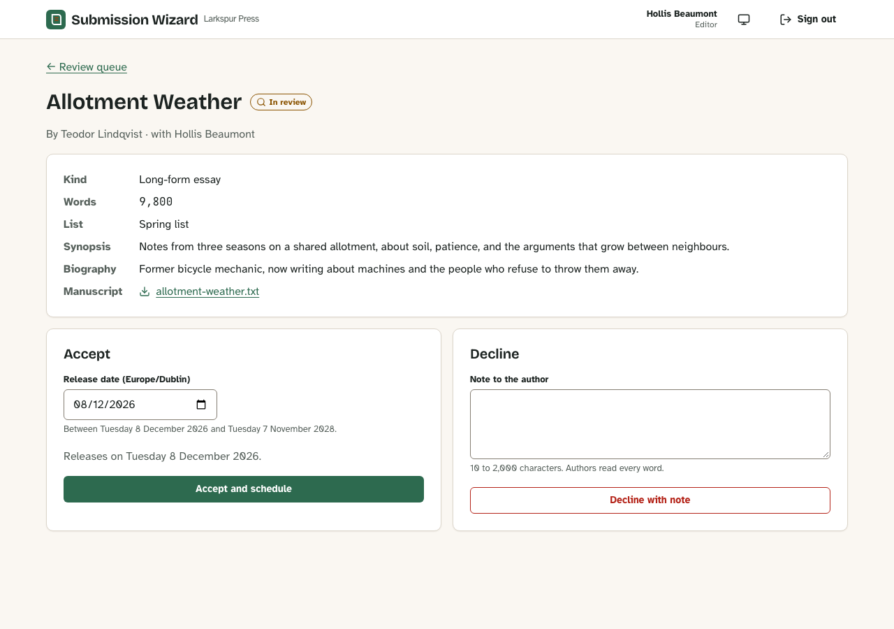
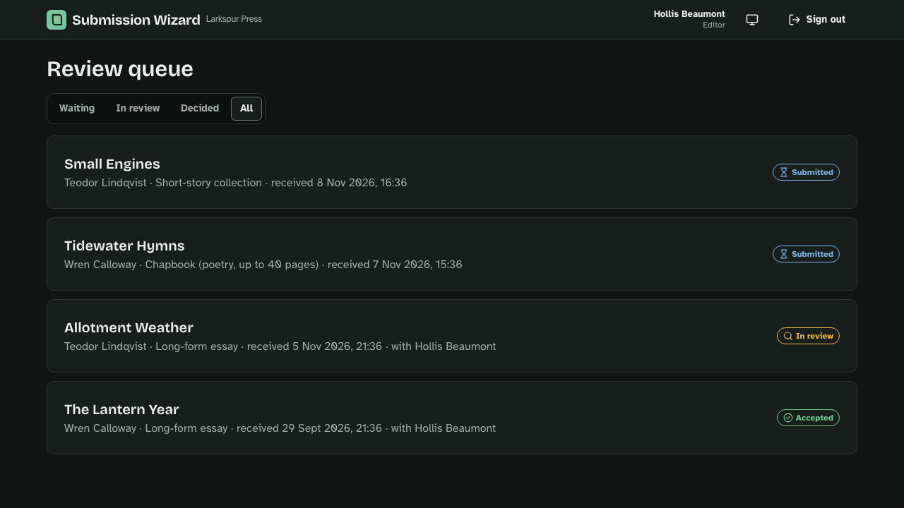
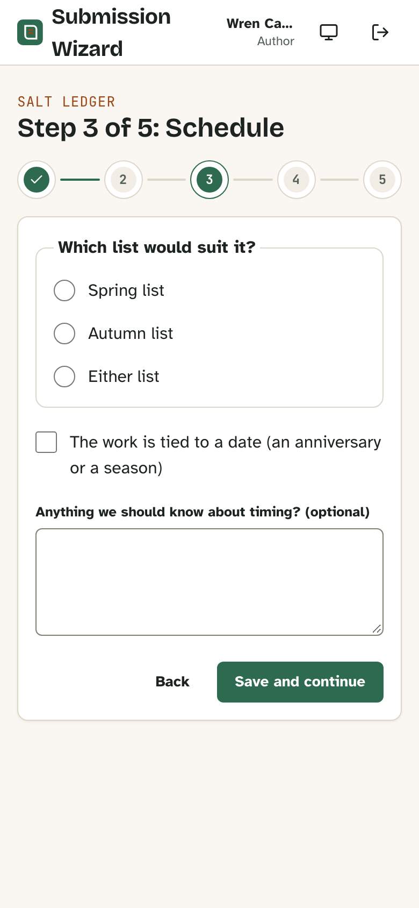

# Screenshots

Screenshots of the app with the seeded demo data; the README shows the first.

To recapture them, run the app ([getting started](../tutorials/getting-started.md)), reseed with `npm run db:setup`, turn on reduced motion, and keep each file under 400 KB:

| File                     | Size and theme               | State                                                                     |
| ------------------------ | ---------------------------- | ------------------------------------------------------------------------- |
| `wizard-review-step.png` | 1280×860, light              | **Wren (author)** → **Continue** on _Salt Ledger_ → **Review and submit** |
| `wizard-phone.png`       | 390×844 at 2× density, light | The same draft's **Schedule** step                                        |
| `review-queue-dark.png`  | 1280×720, dark               | **Hollis (editor)** → the **All** filter                                  |
| `review-decision.png`    | 1280×900, light, full page   | As Hollis, the **In review** filter → _Allotment Weather_                 |

