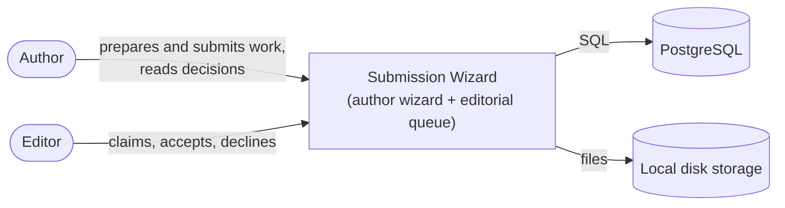
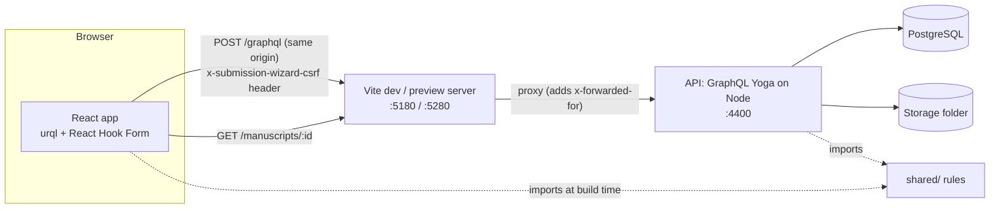
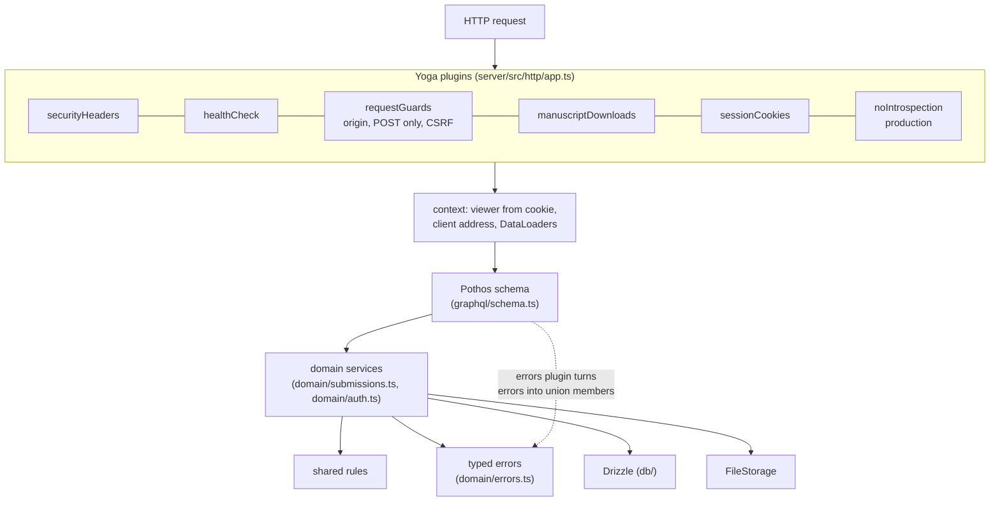
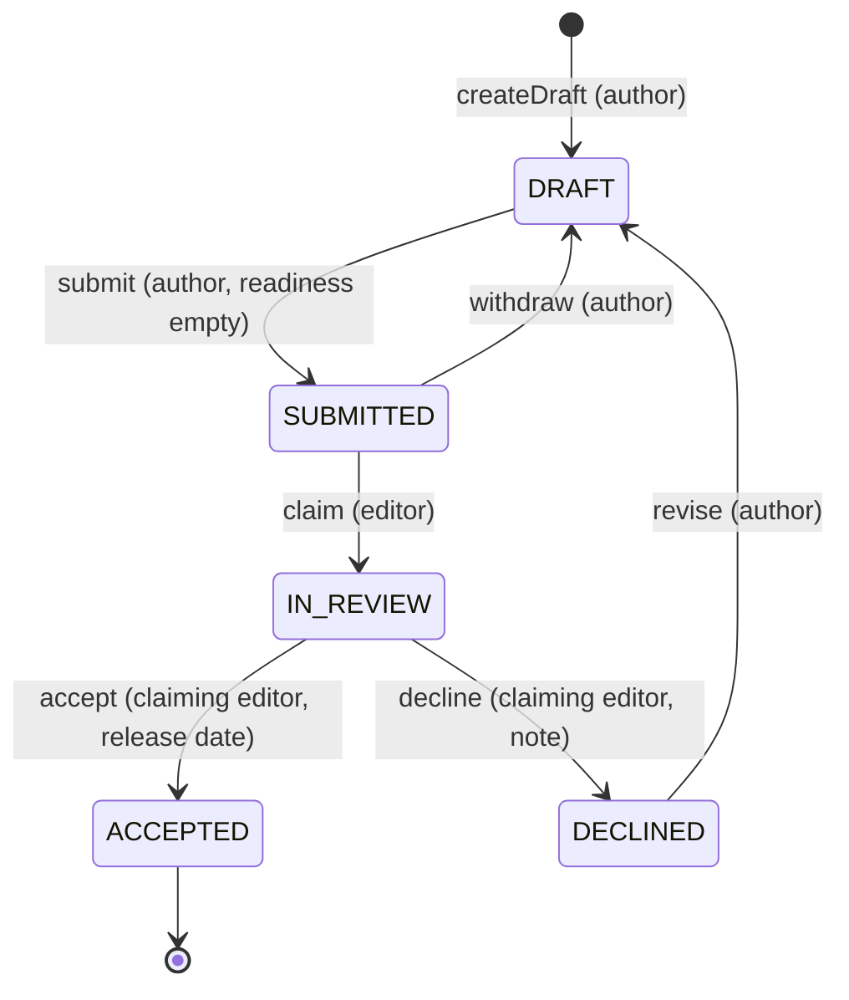
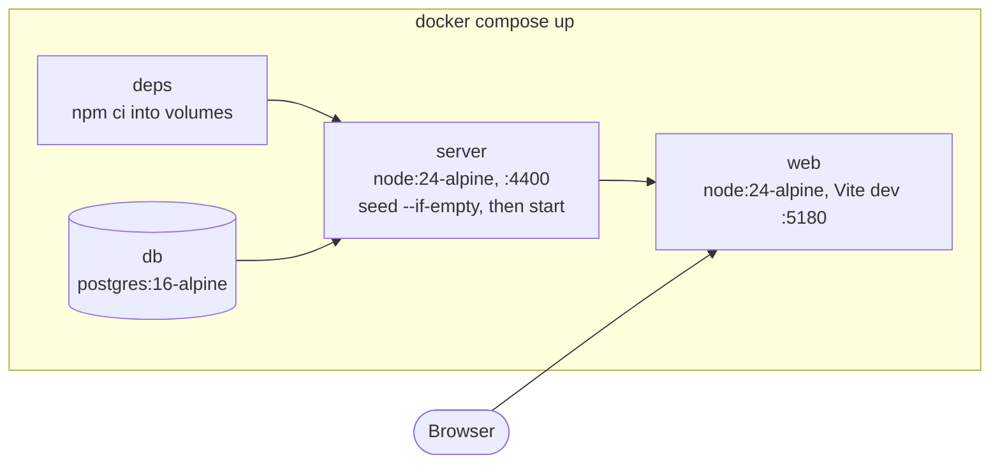

# Architecture

Structured after [arc42](https://arc42.org) (lite), with [C4](https://c4model.com) diagrams in Mermaid. Decisions are in [docs/adr](../adr/README.md); the hardest part has its own page: [the wizard and concurrency](wizard-and-concurrency.md).

## 1. Goals

Authors prepare a submission to a small press over several sittings; editors work through a queue and decide. [Scope](scope.md) lists goals and non-goals, and the [feature catalogue](../reference/features.md) lists every feature.

| Priority | Quality goal                                                                                                  | Verified by                                                                                                                |
| -------- | ------------------------------------------------------------------------------------------------------------- | -------------------------------------------------------------------------------------------------------------------------- |
| 1        | **No lost work.** A save never silently overwrites a newer one; unsaved edits are not dropped without asking. | Conflict tests at API, component and end-to-end level; guard tests ([traceability](../testing/traceability.md)).           |
| 2        | **Rules hold everywhere.** Browser and server agree; the database backs up the invariants.                    | Shared-rule unit tests; API tests that bypass the service with raw SQL.                                                    |
| 3        | **Manuscripts stay confidential.** Only the author, and editors after submission, can read one.               | Isolation and download tests; [threat model](../security/threat-model.md).                                                 |
| 4        | **Accessible.** WCAG 2.2 AA as the target.                                                                    | Role-based queries in every UI test, keyboard paths, contrast and axe checks ([ACCESSIBILITY.md](../../ACCESSIBILITY.md)). |

## 2. Constraints

- TypeScript in strict mode on Node 22.12+ or 24+; PostgreSQL as the only service (no Redis, object store or mail server).
- Permissively licensed dependencies only ([THIRD_PARTY_NOTICES.md](../../THIRD_PARTY_NOTICES.md)).
- Accounts are seeded and fictional; there is no sign-up or email.

## 3. Context (C4 level 1)



## 4. Solution strategy

Rules are defined once in `shared/` and run on both sides; expected failures are typed result unions; concurrent edits are caught by a version column; the workflow is a table backed by check constraints; the queue uses keyset pages; uploads are judged by content; sessions are signed cookies with a CSRF header; the client cache is replaced per session. Each is a [decision record](../adr/README.md).

## 5. Building blocks

### Containers (C4 level 2)



`shared/` runs in both places and imports nothing platform-specific; `server/` holds the schema, domain services, Drizzle tables, SQL migrations and auth; `web/` holds the pages. Each workspace declares its own dependencies. Folder map and layering rules: [project structure](../reference/project-structure.md).

### API components (C4 level 3)



The plugins add the [security headers](../security/threat-model.md#http-security-headers) to every response, answer `/healthz`, refuse foreign origins, GraphQL over GET and POSTs without the CSRF header, and serve `/manuscripts/:id` after the same visibility check GraphQL uses ([transport](../reference/api.md#transport)). The context holds the viewer from the signed cookie unless revoked, the client address for rate limits, fresh DataLoaders and a cookie collector. Resolvers stay thin: domain services take `(services, viewer, …)`, check the viewer first and throw typed errors, which become union members; anything else is masked.

## 6. Runtime view

### Saving a step

The sequence, including two tabs racing, is drawn in [wizard and concurrency](wizard-and-concurrency.md#saving-a-step).

### Submit, claim, decide



`TRANSITIONS` in [`shared/src/workflow.ts`](../../shared/src/workflow.ts) defines every move; the client uses it only to choose which buttons to show. `transition()` refuses a malformed id, locks the record (`SELECT … FOR UPDATE`), asks the table, applies the move's own rules, updates status and version and records any notification in one transaction. Check constraints repeat the invariants ([data model](../reference/data-model.md)). Drafts are editable; an accepted submission accepts changes to `synopsis`, `penName` and `bio` only; other statuses are read-only for authors.

### Sign-in, session and revocation

```mermaid
sequenceDiagram
  actor U as Person
  participant B as Browser
  participant API as Yoga
  participant DB as Postgres
  U->>B: email + password
  B->>API: POST signIn (x-submission-wizard-csrf)
  API->>API: rate limits (client; client + email; email)
  API->>DB: SELECT user WHERE lower(email) = …
  API->>API: scrypt verify (decoy hash if no user)
  API-->>B: Set-Cookie submission_wizard_session=<payload>.<HMAC>; HttpOnly; SameSite=Lax; Max-Age=43200
  B->>B: replace the urql client
  Note over B,API: every later request
  B->>API: POST /graphql + cookie
  API->>API: verify HMAC and expiry
  API->>DB: SELECT user (with sessions_valid_after)
  API->>API: viewer = null if the token predates sessions_valid_after
  Note over U,DB: sign-out
  B->>API: POST signOut
  API->>DB: UPDATE users SET sessions_valid_after = now
  API-->>B: Set-Cookie submission_wizard_session=; Max-Age=0
  B->>B: replace the urql client
```

The logic lives in [`domain/auth.ts`](../../server/src/domain/auth.ts) and [`auth/session.ts`](../../server/src/auth/session.ts); the resolvers only set the cookie, and every time comes from the injected clock.

### Upload pipeline

```mermaid
sequenceDiagram
  participant B as Browser
  participant Y as Yoga (multipart)
  participant S as attachManuscript
  participant F as FileStorage
  participant DB as Postgres
  B->>Y: multipart: operations + map + file
  Y->>Y: body ≤ 5 MB + 64 KB, else 413 before buffering
  Y->>S: File, after file.size ≤ 5 MB
  S->>S: draft visible and editable? whole file is PDF or UTF-8?
  S->>F: save bytes under a random UUID (exclusive create)
  S->>DB: BEGIN; insert manuscript; versioned update; delete the replaced record; COMMIT
  alt database refuses (conflict, not found)
    S->>F: remove the new file
  else committed
    S->>F: remove the replaced file (a failure is logged, not reported)
  end
  S-->>B: success or an error member
```

## 7. Deployment



Locally, `npm run dev` runs the API on 4400 and Vite on 5180 against any Postgres; the end-to-end suite uses 4401 and the preview server on 5280 ([ports](../reference/configuration.md#ports)). A production deployment is not covered: it would need TLS and HSTS in front, `NODE_ENV=production` with a strong `SESSION_SECRET`, `TRUST_PROXY` set to the number of proxies, object storage behind `FileStorage`, and the web CSP copied to whatever serves the build.

## 8. Cross-cutting concepts

- **Validation.** The shared Zod schemas run in React Hook Form and again on the server (`draftPatchSchema`, strict); GraphQL inputs are closed; configuration is parsed with Zod at start-up.
- **Errors.** Typed errors become union members; unexpected ones are masked and logged as JSON without secrets ([error model](../reference/api.md#error-model)).
- **Dates.** A release date is a `date` in `PRESS_TIME_ZONE`, never an instant. `todayIn` and the date formatting build their output from `formatToParts`, so ICU's punctuation does not matter.
- **Performance.** Per-request DataLoaders keep a queue page at a fixed number of queries (a test compares pages of 2 and 4); queue pages are index range reads; uploads are size-checked before they are read.
- **The client.** One route serves `new` and saved drafts, so the first save swaps the URL without remounting. urql sends every operation by POST with the CSRF header. After navigation focus moves to the page's `h1`; success messages go through one polite live region.

## 9. Risks and technical debt

Security residual risks are in the [threat model](../security/threat-model.md).

| Item                                       | Effect                                                                              | Mitigation                                                                                                    |
| ------------------------------------------ | ----------------------------------------------------------------------------------- | ------------------------------------------------------------------------------------------------------------- |
| Drizzle tables mirror the SQL by hand      | A mismatch shows only when a query runs                                             | Every integration test runs on a freshly migrated database.                                                   |
| In-memory, per-process rate limiter        | Several processes each allow the full budget                                        | A shared store would be needed for more than one process.                                                     |
| Sign-out ends every session of the account | No single-device sign-out                                                           | [ADR 0007](../adr/0007-signed-cookie-sessions-csrf-header-and-revocation.md); a session table would allow it. |
| Sessions last 12 hours and are not renewed | A long sitting can outlast the session                                              | The wizard keeps the edits and offers sign-in in a new tab.                                                   |
| Local-disk storage                         | Unsuitable for several API instances; a crash after a commit can leave a stray file | `FileStorage` is the seam for object storage.                                                                 |

The [glossary](../reference/glossary.md) defines the domain terms.
