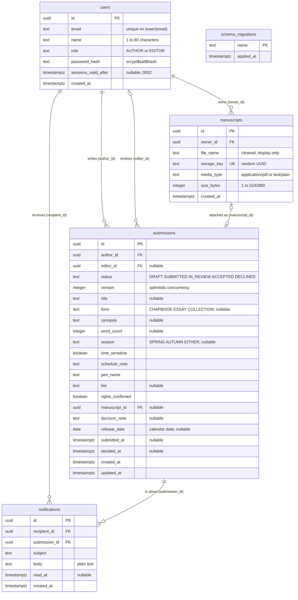

# Data model

PostgreSQL 16, the version CI tests against. The SQL migrations in [`server/src/db/migrations`](../../server/src/db/migrations) are the source of truth; [`server/src/db/schema.ts`](../../server/src/db/schema.ts) mirrors them as typed Drizzle tables. Plain SQL keeps the check constraints and partial indexes readable exactly as Postgres sees them, where generated migrations (Drizzle Kit) or a heavier ORM would hide them; the cost is keeping the Drizzle tables in step by hand, which every integration test checks by running on a freshly migrated database.

## Constraints and why

| Table         | Constraint                                              | Rule                                                                                                                                       | Why                                                                                          |
| ------------- | ------------------------------------------------------- | ------------------------------------------------------------------------------------------------------------------------------------------ | -------------------------------------------------------------------------------------------- |
| `submissions` | `submitted_have_timestamp`                              | `status = 'DRAFT' OR submitted_at IS NOT NULL`                                                                                             | Anything past draft was submitted at a known time; the queue orders by it.                   |
| `submissions` | `review_has_editor`                                     | `status NOT IN ('IN_REVIEW','ACCEPTED','DECLINED') OR editor_id IS NOT NULL`                                                               | A decision always has an owner; only the claiming editor may decide.                         |
| `submissions` | `accepted_has_release_date`                             | `status <> 'ACCEPTED' OR release_date IS NOT NULL`                                                                                         | An acceptance without a date would leave the author's message incomplete.                    |
| `submissions` | `declined_has_note`                                     | `status <> 'DECLINED' OR decision_note IS NOT NULL`                                                                                        | Authors always hear why.                                                                     |
| `submissions` | `status`, `form`, `season` CHECK lists                  | Values from the shared lists                                                                                                               | The database refuses values the application does not know.                                   |
| `users`       | `role` CHECK, `name` length CHECK                       | `AUTHOR`/`EDITOR`; 1–80 characters                                                                                                         | Mirrors the application's types.                                                             |
| `manuscripts` | `media_type` CHECK, `size_bytes` CHECK (1 to 5,242,880) | Only sniffed types; never empty, never over 5 MB                                                                                           | Repeats the upload rules ([ADR 0006](../adr/0006-sniff-uploads-store-under-random-keys.md)). |
| `manuscripts` | `storage_key` UNIQUE                                    | One record per stored file                                                                                                                 | A key can never be shared, so deleting one record's file cannot remove another's.            |
| all           | Foreign keys                                            | `author_id`, `editor_id`, `owner_id` → `users`; `manuscript_id` → `manuscripts`; `recipient_id` → `users`; `submission_id` → `submissions` | No dangling references.                                                                      |

The workflow constraints are proven by the API test "keeps database invariants even if code skips the service", which updates records with raw SQL and expects the named constraint to refuse ([ADR 0004](../adr/0004-workflow-as-a-table-invariants-in-the-database.md)).

**There are no triggers.** The application sets `updated_at = now()` and `version = version + 1` in the same `UPDATE` that writes a change (`updateWithVersion` and `transition` in [`submissions.ts`](../../server/src/domain/submissions.ts)), so the version check and the bump cannot be separated.

## Indexes and why

| Index                                                          | Columns                                | Serves                                                                                                                                                                           |
| -------------------------------------------------------------- | -------------------------------------- | -------------------------------------------------------------------------------------------------------------------------------------------------------------------------------- |
| `users_email_lower` (unique)                                   | `lower(email)`                         | Case-insensitive sign-in lookup; one account per email whatever its case.                                                                                                        |
| `submissions_author`                                           | `(author_id, updated_at DESC)`         | An author's list, most recently changed first (`listOwn`).                                                                                                                       |
| `submissions_queue`                                            | `(status, submitted_at DESC, id DESC)` | A single-status queue page read in order, with the keyset comparison on `(submitted_at, id)`.                                                                                    |
| `submissions_queue_order` (partial, `WHERE status <> 'DRAFT'`) | `(submitted_at DESC, id DESC)`         | Queue filters with several statuses ("Decided", "All"): read in order and skip unwanted statuses (migration `0003`). Drafts, which editors never see, are left out of the index. |
| `notifications_recipient`                                      | `(recipient_id, created_at DESC)`      | The inbox, newest first.                                                                                                                                                         |
| Primary keys, `storage_key` unique                             |                                        | Lookups by id and by key.                                                                                                                                                        |

## Migrations

| File                                                                                        | Change                                                                                                                               |
| ------------------------------------------------------------------------------------------- | ------------------------------------------------------------------------------------------------------------------------------------ |
| [`0001_init.sql`](../../server/src/db/migrations/0001_init.sql)                             | Tables, checks, foreign keys and the first indexes.                                                                                  |
| [`0002_session_revocation.sql`](../../server/src/db/migrations/0002_session_revocation.sql) | `users.sessions_valid_after` for sign-out revocation ([ADR 0007](../adr/0007-signed-cookie-sessions-csrf-header-and-revocation.md)). |
| [`0003_queue_order_index.sql`](../../server/src/db/migrations/0003_queue_order_index.sql)   | `submissions_queue_order` for multi-status queue filters ([ADR 0005](../adr/0005-keyset-pagination-for-the-queue.md)).               |

The migrator ([`migrate.ts`](../../server/src/db/migrate.ts)) applies each file not yet in `schema_migrations`, in name order, inside its own transaction. Files are never edited after release except for comments; a change is a new file.

## Dates and times

- `release_date` is a `date`: a calendar date in the press's time zone, never converted to an instant.
- Every other time is `timestamptz`. The queue cursor formats `submitted_at` in Postgres with microseconds, because a JavaScript `Date` keeps only milliseconds.
