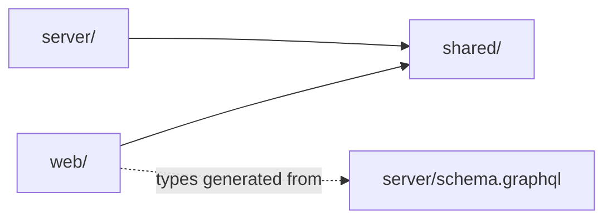

# Project structure

One TypeScript repository with three npm workspaces. The root holds only shared tooling.

```text
autosave-submission-wizard/
├── shared/                  Platform-neutral rules (browser and server)
│   ├── src/
│   │   ├── submission.ts    Step schemas (Zod), readiness checklist, locked-field lists, labels
│   │   ├── workflow.ts      Roles, actions, the TRANSITIONS table, nextStatus, availableActions
│   │   ├── dates.ts         Calendar-date rules: todayIn, addDays, releaseDateProblem, formatting
│   │   ├── uploads.ts       Size cap, content sniffing, display-safe file names
│   │   └── index.ts         Package entry
│   └── tests/               Unit tests for every rule
├── server/                  GraphQL API (Node)
│   ├── schema.graphql       Committed SDL, dumped from the Pothos schema
│   ├── src/
│   │   ├── main.ts          Process entry: Node HTTP server around the Yoga app
│   │   ├── config.ts        Environment variables, parsed with Zod at start-up
│   │   ├── logger.ts        One JSON object per line
│   │   ├── auth/            scrypt passwords, HMAC session tokens
│   │   ├── db/              Drizzle tables, pool, migrator, seed, migrations/*.sql
│   │   ├── domain/          Services (submissions, auth), errors, viewer guards, storage, notifications, rate limit
│   │   ├── graphql/         Pothos builder, schema, per-request context and DataLoaders, SDL dump
│   │   └── http/app.ts      Yoga app and plugins: health, security headers, guards, downloads, cookies
│   └── tests/               Integration tests through app.fetch against Postgres, plus unit tests
├── web/                     React single-page app
│   ├── codegen.ts           GraphQL Code Generator config (reads ../server/schema.graphql)
│   ├── vite.config.ts       Dev/preview servers, proxy, HTTP headers and CSP
│   ├── src/
│   │   ├── App.tsx          Route table
│   │   ├── api/             urql client, provider, operations (documents), result helpers
│   │   ├── gql/             Generated types (do not edit)
│   │   ├── routes/          Shell (Root), sign-in, sign-out, home, session context
│   │   ├── wizard/          The five-step wizard
│   │   ├── author/          Submissions list and inbox, submission view
│   │   ├── editor/          Review queue and decision screen
│   │   ├── components/      Header, theme, buttons, notices, dialogs, the live region, status pill, page hooks
│   │   └── styles/          Design tokens and CSS
│   └── tests/               Browser component tests and the design-token checks (Vitest browser mode, real Chromium)
├── e2e/                     Playwright end-to-end tests against the full stack
├── scripts/dev.mjs          Starts API and web together; stops both on Ctrl-C
├── docs/                    Documentation (see docs/README.md)
└── .github/                 CI, code analysis, dependency review, Scorecard, templates
```

## Dependency rules



- **`shared/` imports nothing platform-specific.** ESLint refuses `node:*`, `react` and `react-dom` imports in `shared/src` ([`eslint.config.js`](../../eslint.config.js)).
- **`web/` never imports `server/`.** It talks to the API over HTTP only; its types come from the committed SDL through code generation. CI regenerates both and fails on a difference.
- **Inside `server/`, imports point downwards:** `http` → `graphql` → `domain` → `db` and `auth` (a higher layer may skip one). The seed script in `db/` is the one exception: it uses `FileStorage` and `hashPassword` to write demo data. Resolvers in `graphql/schema.ts` stay thin and call `domain/` services; the services take `(services, viewer, …)`, check the viewer first and throw typed errors.
- **Validation lives at the boundary.** Input is parsed with the shared Zod schemas in `domain/submissions.ts`; GraphQL input types are closed. SQL is parameterised by Drizzle everywhere.
- **Each workspace declares what it imports** in its own `package.json`; knip reports unused files, exports and dependencies.

Generated files (`server/schema.graphql`, `web/src/gql/`) and the lockfile are never edited by hand; see [CONTRIBUTING.md](../../CONTRIBUTING.md#security-boundaries-and-generated-files). Run-time and tool output (storage folders, coverage, test results, `dist/`) is ignored by Git.
