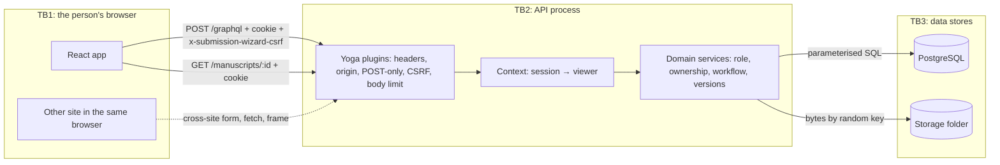

# Threat model

STRIDE per trust boundary, for the code in this repository. Reporting is covered by [SECURITY.md](../../SECURITY.md), requirement coverage by the [ASVS mapping](asvs-mapping.md), dependencies by [supply chain](supply-chain.md). Each threat names the test that covers it; feature tests are in the [traceability matrix](../testing/traceability.md).

## System overview

A React single-page app talks, through a same-origin proxy (Vite), to one GraphQL API process. The API keeps records in PostgreSQL and manuscript files in a local folder. Accounts are seeded; there is no sign-up.

| Asset                                     | Why it matters                                           |
| ----------------------------------------- | -------------------------------------------------------- |
| Unpublished manuscripts and their details | Confidential until accepted; the author's work.          |
| Email addresses and biographies           | Personal data.                                           |
| Editorial decisions and notes             | Must come from the claiming editor and reach the author. |
| Session tokens and `SESSION_SECRET`       | Whoever holds them acts as the user.                     |
| Password hashes                           | Open to offline guessing if leaked.                      |

Actors: authors, editors, anonymous visitors, hostile sites in the same browser, and malicious uploads.

## Data flow and trust boundaries

Everything crossing TB1 → TB2 is untrusted, the app's own requests included. Inside TB2, authors reach only their own work and editors never reach drafts or another editor's claim. Across TB2 → TB3, nothing user-supplied becomes SQL text or a path.

## STRIDE: browser to API (TB1 → TB2)

| STRIDE | Threat                                         | Mitigation (where)                                                                                                                                                            | Test                                                                                                                                                                                                    | Residual risk                                                                               |
| ------ | ---------------------------------------------- | ----------------------------------------------------------------------------------------------------------------------------------------------------------------------------- | ------------------------------------------------------------------------------------------------------------------------------------------------------------------------------------------------------- | ------------------------------------------------------------------------------------------- |
| S      | Forged or tampered session token               | HMAC-SHA256 with expiry, constant-time comparison (`auth/session.ts`); production refuses a missing, short or example secret (`config.ts`)                                    | auth "rejects tampering, wrong secrets and garbage", "expires"; config "requires a strong, non-example session secret in production"                                                                    | A leaked `SESSION_SECRET` forges any session.                                               |
| S      | Password guessing                              | scrypt with random salts and a decoy hash; 50 attempts per client and 10 per client and email in 5 minutes, 100 per email in 15 minutes (`domain/auth.ts`)                    | "limits repeated sign-in attempts", "caps attempts on one account however many addresses they come from"                                                                                                | In memory, per process; no MFA. Ten or more addresses can block one account for 15 minutes. |
| S      | A forged `x-forwarded-for` for a fresh budget  | Ignored unless `TRUST_PROXY` is set; then the entry the trusted proxies appended is used, counted from the right (`clientAddress`)                                            | "keys the limit on the connection, not on a forwarded-for header the client chose", "behind a trusted proxy, keys the limit on the entry the proxy added, not one the client wrote"                     | A wrong hop count trusts a client-written entry.                                            |
| S      | A stolen token used after sign-out             | `users.sessions_valid_after` revokes every token issued before sign-out (`viewerFor`)                                                                                         | "sets a signed, HTTP-only, SameSite cookie and clears it on sign-out", "signing out revokes the session token itself, not just the cookie"                                                              | Sign-out is per account, not per device.                                                    |
| T      | Cross-site request forgery, multipart included | Required `x-submission-wizard-csrf`; CORS approves preflights only for `ALLOWED_ORIGINS`; a foreign `Origin` gets 403 everywhere; `SameSite=Lax` (`requestGuards`)            | "refuses POSTs without the CSRF header or from foreign origins"                                                                                                                                         | Relies on browsers enforcing CORS preflights.                                               |
| T      | Mass assignment of status, version or author   | Closed `DraftInput`; strict `draftPatchSchema`; status and ownership set only by services                                                                                     | rules "rejects unknown fields and out-of-range values"                                                                                                                                                  | —                                                                                           |
| T      | Malicious upload                               | Body cap before buffering, `file.size` check, the whole file checked for PDF or UTF-8, a random key, the name cleaned and kept as data (`attachManuscript`, `uploads.ts`)     | "judges files by their bytes and size, and cleans the name"; e2e "a disguised binary is rejected however it is named"                                                                                   | No malware checking; a valid PDF can still be harmful.                                      |
| R      | A decision that cannot be attributed           | `editor_id` (the claiming editor only) and `decided_at`; the author's message in the same transaction                                                                         | "only lets the claiming editor decide, and requires a note to decline"                                                                                                                                  | No separate audit log.                                                                      |
| I      | Cross-origin reads                             | POST-only GraphQL; CORS allow-list with credentials; `Cross-Origin-Resource-Policy: same-origin`                                                                              | "serves GraphQL over POST only, and lets only the app’s own origin read responses"                                                                                                                      | —                                                                                           |
| I      | Clickjacking, MIME sniffing, referrer leaks    | The [headers below](#http-security-headers) on every API and preview response                                                                                                 | "sends security headers on every response, refusals and health checks included"; e2e headers tests                                                                                                      | The dev server sends no CSP.                                                                |
| I      | XSS stealing data                              | React escapes text; messages are plain text; the built app's CSP allows `'self'` only; the session cookie is HTTP-only                                                        | e2e "the app is served with a strict CSP and runs without violating it"                                                                                                                                 | —                                                                                           |
| I      | Error details or schema leak                   | Unexpected errors masked as `Unexpected error.` and logged; introspection off in production; GraphiQL off; malformed ids answered as not found rather than as database errors | "masks unexpected errors: the client gets a generic message and the detail is only logged", "turns off introspection in production", "answers a malformed id with NotFoundError on every workflow move" | Development allows introspection by design.                                                 |
| I      | Cached data shown to the next person           | The urql client is replaced on sign-in and sign-out                                                                                                                           | session "signs out with a brand-new client, so nothing cached survives"                                                                                                                                 | —                                                                                           |
| D      | Oversized bodies, unbounded lists              | Body limit; `first` clamped to 1–50; 50 notifications; at most 10,000 limiter keys                                                                                            | "refuses an oversized body before buffering it", rate "never remembers more than a fixed number of keys"                                                                                                | No query depth or cost limit; no global request limit.                                      |
| E      | Editor operations as an author, or the reverse | `requireRole` in every service; the transition table checks the role                                                                                                          | "only lets authors write drafts, and only their own"; e2e "roles stay in their lanes"                                                                                                                   | —                                                                                           |

## STRIDE: between people (inside TB2)

| STRIDE | Threat                                                             | Mitigation (where)                                                                                                     | Test                                                                                                               |
| ------ | ------------------------------------------------------------------ | ---------------------------------------------------------------------------------------------------------------------- | ------------------------------------------------------------------------------------------------------------------ |
| I      | Reading another author's work, or a draft as an editor             | Every lookup goes through `getSubmission` and `visibleTo`; not-yours and not-found give the same answer                | "never shows drafts to editors"                                                                                    |
| I      | Downloading someone else's manuscript                              | `/manuscripts/:id` reuses the same visibility check; anything else is 404                                              | "stores a PDF under a random key and serves it only to people who may see it"                                      |
| I      | Collecting other people's email addresses                          | `User.email` resolves only for the account itself, and for editors looking at authors                                  | "shows an email address only to its owner, and authors’ addresses to editors"                                      |
| T      | Changing another author's draft, or a lost update from a stale tab | Writes match `author_id` and `version` in the `UPDATE` (`updateWithVersion`)                                           | "refuses a stale version with the current one, so the client can reload"                                           |
| E      | Deciding another editor's claim, or skipping review                | Status and role checked under a record lock; only the claiming editor decides; check constraints repeat the invariants | "lets exactly one of two editors claiming at once win", "keeps database invariants even if code skips the service" |

## STRIDE: API to stores (TB2 → TB3)

| STRIDE | Threat                               | Mitigation (where)                                                                                                                                      | Test                                                                                                                                                       | Residual risk                                                  |
| ------ | ------------------------------------ | ------------------------------------------------------------------------------------------------------------------------------------------------------- | ---------------------------------------------------------------------------------------------------------------------------------------------------------- | -------------------------------------------------------------- |
| T      | SQL injection                        | Drizzle parameterises every query; the one interpolated identifier (the database name in `ensureDatabase`) comes from configuration, stripped of quotes | Every integration test runs real SQL                                                                                                                       | —                                                              |
| T      | Path traversal through names or keys | Keys are random UUIDs, checked before every read or delete; names are data only; exclusive create (`domain/storage.ts`)                                 | "judges files by their bytes and size, and cleans the name"                                                                                                | —                                                              |
| T      | Stray files after a refused change   | The new file is removed when the transaction fails; the replaced one after the commit, with a failure there logged instead of reported                  | "rejects an upload against a stale version without keeping the file", "still reports a committed replacement as saved when the old file cannot be deleted" | A crash between commit and delete leaves an unreferenced file. |
| I      | Password hashes in a database dump   | scrypt with per-password salts                                                                                                                          | auth "salts every hash and never matches the decoy or malformed values"                                                                                    | Offline guessing of weak passwords.                            |
| D      | Storage exhaustion                   | 5 MB per file; replaced files deleted                                                                                                                   | "removes the replaced manuscript, its record and its file"                                                                                                 | No per-author quota.                                           |

## HTTP security headers

This table is the reference for the headers; other pages link here. Every API response (GraphQL, downloads, health, and early 4xx refusals) carries:

| Header                         | Value                                                                                                                                                |
| ------------------------------ | ---------------------------------------------------------------------------------------------------------------------------------------------------- |
| `Content-Security-Policy`      | `default-src 'none'; frame-ancestors 'none'; base-uri 'none'; form-action 'none'` (downloads: `default-src 'none'; frame-ancestors 'none'; sandbox`) |
| `X-Content-Type-Options`       | `nosniff`                                                                                                                                            |
| `X-Frame-Options`              | `DENY`                                                                                                                                               |
| `Referrer-Policy`              | `no-referrer`                                                                                                                                        |
| `Cross-Origin-Opener-Policy`   | `same-origin`                                                                                                                                        |
| `Cross-Origin-Resource-Policy` | `same-origin`                                                                                                                                        |
| `Permissions-Policy`           | `camera=(), microphone=(), geolocation=(), payment=(), usb=()`                                                                                       |

Downloads also send `Content-Disposition: attachment` and `Cache-Control: private, no-store`, and text files `Content-Type: text/plain; charset=utf-8`.

The preview server, which serves the production build, sends `Content-Security-Policy: default-src 'self'; script-src 'self'; style-src 'self'; img-src 'self'; font-src 'self'; connect-src 'self'; object-src 'none'; base-uri 'none'; form-action 'self'; frame-ancestors 'none'`, with `nosniff`, `X-Frame-Options: DENY`, `Referrer-Policy: strict-origin-when-cross-origin`, `Cross-Origin-Opener-Policy: same-origin` and the same `Permissions-Policy`. The dev server sends these without the CSP, because React Fast Refresh injects an inline script. HSTS belongs to the TLS-terminating proxy of a deployment.

One Yoga `onResponse` plugin sets them, because Yoga runs it for responses ended early in `onRequest` too, so every path is covered and testable without a proxy. Fonts are emitted as files (`assetsInlineLimit: 0`), so `font-src` needs no `data:`.

## Abuse cases

1. **A hostile page posts a multipart form to `/graphql`:** no CSRF header, so 400; a `fetch` with the header fails the CORS preflight and gets 403.
2. **A hostile page frames the app:** `frame-ancestors 'none'` and `X-Frame-Options: DENY`.
3. **An executable named `invoice.pdf`, or text with binary after the first few kilobytes:** neither PDF nor valid UTF-8, so nothing is stored.
4. **Guessed or malformed ids** in pages, downloads or mutations: the same answer as a missing id.
5. **Two editors claim at once:** the record lock lets one win.
6. **A copied cookie after sign-out:** the token predates `sessions_valid_after`, so the request is anonymous.
7. **A flood of sign-ins with unique emails:** the per-client budget stops it; the limiter's memory is capped.
8. **A rotating `x-forwarded-for`:** ignored without `TRUST_PROXY`; with it, only the trusted proxy's entry counts.
