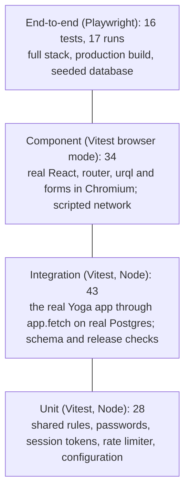

# Testing strategy

This page is the one place that states test counts and coverage; other pages link here.

## Levels

| Level       | Files and counts                                                                                          | Proves                                                                         |
| ----------- | --------------------------------------------------------------------------------------------------------- | ------------------------------------------------------------------------------ |
| Unit        | `shared/tests/rules.test.ts` 17, `server/tests/auth.test.ts` 5, `rateLimit.test.ts` 2, `config.test.ts` 4 | Shared rules, passwords and tokens, the limiter's memory, configuration        |
| Integration | `server/tests/api.test.ts` 40, `schema.test.ts` 2, `release.test.ts` 1                                    | The real Yoga app on real Postgres: transport, sessions, data, workflow, queue |
| Component   | `web/tests`: wizard 13, screens 10, session 5, header 3, design tokens 3                                  | Screens, forms, focus, announcements and dialogs in Chromium; token contrast   |
| End-to-end  | `e2e/*.spec.ts` 16                                                                                        | Journeys across pages and tabs on the production build, on three device sizes  |

**Totals: 105 Vitest tests and 16 Playwright tests (17 runs on desktop, phone and tablet), all passing on 2026-10-17.** Playwright's projects are `desktop` (every test without `@tablet`), `mobile` (Pixel 7, tests tagged `@mobile`) and `tablet` (768×1024 with touch, tests tagged `@tablet`). Test-by-test mapping: [traceability](traceability.md).

## Tools

Vitest 5 in Node and in browser mode (Playwright provider), Playwright 1.64 with Chromium, V8 coverage. Browser tests use the full Chromium build in "new headless" mode (`channel: 'chromium'`), because the slim headless shell does not render frames on some macOS versions.

## Coverage

`npm run test:coverage` enforces the thresholds in [`vitest.config.ts`](../../vitest.config.ts): 87% of lines, 85% of statements, 85% of functions and 74% of branches overall; 100% of lines and functions in `shared/src`; 95% of lines in `server/src/domain`.

| Area (lines)            | 2026-10-17                                                    |
| ----------------------- | ------------------------------------------------------------- |
| `shared/src`            | 100%                                                          |
| `server/src/domain`     | 97.0%                                                         |
| `server/src/config.ts`  | 97.1%                                                         |
| `server/src/auth`       | 96.6%                                                         |
| `server/src/http`       | 95.3%                                                         |
| `server/src/graphql`    | 93.4%                                                         |
| `web/src` (all)         | 85.5%                                                         |
| **Everything measured** | **89.2%** (statements 87.1%, functions 88.2%, branches 77.0%) |

`server/src/main.ts`, `db/seed.ts` and `graphql/dumpSchema.ts` are entry points and excluded. The migrator's command-line branch and most of `db/client.ts`'s `DATABASE_URL` handling run only from the command line. `App.tsx` and `Home.tsx` are exercised only by Playwright, whose browser V8 coverage cannot see.

## Test data and determinism

- **Server tests** use `submission_wizard_test`, truncated before each test, with a fixed clock (`2026-03-10T12:00Z`) that also drives session tokens; the rate limiter is reset between tests. With `DATABASE_URL` set, only its host and credentials are used, so the URL's own database is never truncated.
- **Component tests** answer each GraphQL operation from a script, by operation name; nothing is random.
- **End-to-end tests** reseed `submission_wizard_e2e` at start-up and run serially without retries, each on different records. All browsers reach the API from one address and share its sign-in budgets, so tests spread their sign-ins across accounts (`signInAs`).
- **All people and works are fictional;** emails use `example.com`.

## How to run each level

See [run the tests](../how-to/run-the-tests.md).

## CI mapping

What [`.github/workflows`](../../.github/workflows) runs:

| Workflow and job        | Runs                                                                                                                                                                                                                      |
| ----------------------- | ------------------------------------------------------------------------------------------------------------------------------------------------------------------------------------------------------------------------- |
| `ci.yml` → verify       | Against a `postgres:16` service: schema and generated types up to date, lint, knip, format, typecheck, tests with coverage, then the production build and end-to-end tests; the Playwright report is uploaded on failure. |
| `ci.yml` → supply-chain | `npm audit --omit=dev --audit-level=high` (blocking), a full audit (report only) and a CycloneDX SBOM artifact.                                                                                                           |
| `dependency-review.yml` | Pull requests that add dependencies with high or critical advisories fail.                                                                                                                                                |
| `scorecard.yml`         | OpenSSF Scorecard, published with `publish_results: true`; the SARIF is kept as an artifact.                                                                                                                              |
| CodeQL default setup    | A repository setting rather than a file; see [enable the repository's security features](../how-to/enable-repository-security-features.md).                                                                               |

## Known gaps

- CI does not start the Docker Compose stack, so `docker-compose.yml` is not exercised by any automated check.
- CI tests against PostgreSQL 16 and Node from `.nvmrc` (24) only. `engines` also allows Node 22.12+, the oldest Vitest 5 supports.
- There are no load tests. Concurrency correctness rests on versioned updates and record locks, proven by the conflict and simultaneous-claim tests.
- The axe-core audit is run by hand ([how-to](../how-to/audit-accessibility.md)), not in the gate. Screen readers have not been tested by hand.
- The Vite dev server's headers are not tested; the preview server's are.
- There are no screenshot comparisons, and text resizing to 200% is not tested.
